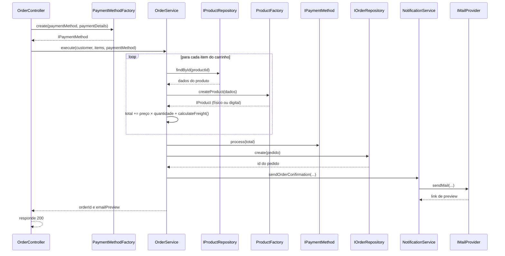

# E-commerce SOLID: do código legado ao container IoC

Backend de e-commerce em TypeScript usado em dois trabalhos encadeados da disciplina de Arquitetura de Software. O segundo trabalho continua o primeiro, por isso os dois vivem neste mesmo repositório e a explicação de cada um está em uma seção deste README.

| | Projeto 1 | Projeto 2 |
|---|---|---|
| **Tema** | Refatoração aplicando os princípios SOLID | Inversão de Controle com InversifyJS |
| **Ponto de partida** | Um `OrderController` "God Class" com toda a lógica do pedido | O resultado do Projeto 1, com a montagem feita à mão (`new`) no `app.ts` |
| **Resultado** | Responsabilidades separadas em camadas, ligadas por interfaces | Montagem automática por um container, com dois modos de execução (`dev` e `test`) |

## Sumário

1. [Visão geral e tecnologias](#visão-geral-e-tecnologias)
2. [Como rodar](#como-rodar)
3. [Projeto 1: refatoração SOLID](#projeto-1-refatoração-solid)
4. [Projeto 2: container IoC com InversifyJS](#projeto-2-container-ioc-com-inversifyjs)
5. [Conceitos aplicados](#conceitos-aplicados)
6. [Limitações e melhorias futuras](#limitações-e-melhorias-futuras)

---

## Visão geral e tecnologias

A API recebe pedidos em `POST /orders`, valida o carrinho, calcula total e frete, processa o pagamento, grava o pedido e envia um e-mail de confirmação.

| Camada | Tecnologia |
|---|---|
| Linguagem e execução | TypeScript, Node.js, `tsx` |
| HTTP | Express |
| Banco de dados | SQLite com Prisma |
| Logs | Winston |
| E-mail | Nodemailer com Ethereal (caixa de e-mail de teste) |
| Injeção de dependência (Projeto 2) | InversifyJS 7 e `reflect-metadata` |
| Variáveis de ambiente (Projeto 2) | `dotenv` |

---

## Como rodar

### 1. Instalação

```bash
npm install
cp .env.example .env
npm run prisma:migrate
npm run prisma:seed
```

O seed cria dois produtos:

| ID | Produto | Tipo | Preço | Frete |
|---|---|---|---|---|
| 1 | O Programador Pragmático | Livro físico | R$ 100 | R$ 10 por linha do carrinho |
| 2 | Clean Code | E-book | R$ 50 | Sem frete |

### 2. Escolha o modo de execução

Os modos são definidos **só** pela variável `APP_ENV` no arquivo `.env`. Nenhum código precisa mudar para alternar entre eles.

| | `APP_ENV=dev` | `APP_ENV=test` |
|---|---|---|
| **E-mail** | `EtherealMailProvider`: envia para o Ethereal e devolve um link de visualização | `ConsoleMailProvider`: imprime o e-mail no console do servidor |
| **Pedidos** | `PrismaOrderRepository`: grava no SQLite (`prisma/dev.db`) | `InMemoryOrderRepository`: guarda em um array na memória (some ao reiniciar) |
| **Internet** | Necessária para o e-mail (Ethereal) | Não necessária |
| **`emailPreview` na resposta** | Link do Ethereal | `null` |

> O catálogo de produtos continua vindo do SQLite nos dois modos, porque o banco é local e não depende de rede.

<!-- CONFIRMAR depois de implementar o Projeto 2: o que o ConsoleMailProvider retorna e o valor de emailPreview no modo test. -->

Para trocar de modo, edite o `.env`, por exemplo:

```env
APP_ENV=test
```

e reinicie o servidor.

### 3. Subir a API

```bash
npm run dev
```

O servidor inicia em `http://localhost:3000` e reinicia sozinho ao salvar arquivos.

### 4. Testar

```bash
curl -X POST http://localhost:3000/orders \
-H "Content-Type: application/json" \
-d '{
  "customer": "cliente@ethereal.email",
  "items": [{ "productId": 1, "quantity": 1 }],
  "paymentMethod": "credit_card",
  "paymentDetails": { "cardNumber": "1234567812345678", "cvv": "123" }
}'
```

Formas de pagamento aceitas: `credit_card`, `debit_card` e `pix` (o Pix não precisa de `paymentDetails`).

Resposta de sucesso:

```json
{
  "message": "Pedido processado com sucesso",
  "orderId": 1,
  "emailPreview": "https://ethereal.email/message/..."
}
```

Respostas de erro:

| Situação | Status | Corpo |
|---|---|---|
| Carrinho vazio | 400 | `{"error":"Carrinho vazio"}` |
| Produto inexistente | 400 | `{"error":"Produto 999 não encontrado"}` |
| Forma de pagamento desconhecida | 400 | `{"error":"Método de pagamento não suportado"}` |
| Cartão de crédito com CVV `000` | 500 | `{"error":"Erro interno"}` |

---

## Projeto 1: refatoração SOLID

### O ponto de partida

O código original concentrava tudo em um único método, `OrderController.processOrder`. Ele funcionava, mas era difícil de manter e de estender. Cinco responsabilidades diferentes conviviam no mesmo lugar:

| # | Responsabilidade | Violação |
|---|---|---|
| 1 | Validar a entrada | SRP: o controller decidia regras de negócio |
| 2 | Calcular preço e frete | OCP e LSP: um `if (product.type === 'physical')` por tipo de produto |
| 3 | Processar o pagamento | OCP: um `if/else` por forma de pagamento |
| 4 | Gravar no banco | DIP e SRP: o controller criava o `PrismaClient` e falava direto com o banco |
| 5 | Enviar o e-mail | DIP e SRP: o controller conhecia o Nodemailer e montava o HTML |

### O que foi feito, princípio por princípio

| Princípio | Problema no código original | Solução aplicada | Onde está a prova |
|---|---|---|---|
| **S** (responsabilidade única) | Um método fazia tudo | Cada responsabilidade ganhou uma classe própria: orquestração, notificação, persistência, pagamento | `services/OrderService.ts`, `services/NotificationService.ts` |
| **O** (aberto/fechado) | Pix exigiria editar um `if/else` no meio do fluxo | Cada forma de pagamento é uma classe que implementa `IPaymentMethod`. Para criar uma nova, basta uma classe nova e uma linha no mapa da factory | `payments/*`, em especial `PixPayment.ts`, criado sem editar nenhuma classe existente |
| **L** (substituição de Liskov) | O frete dependia de checar o tipo (string) do produto | `PhysicalProduct` e `DigitalProduct` implementam `IProduct`. O service chama `calculateFreight()` sem saber qual é qual | `domain/*` e o laço do `OrderService` |
| **I** (segregação de interfaces) | Não havia contratos | Interfaces pequenas, com uma ou duas operações cada | `IPaymentMethod`, `IProductRepository`, `IOrderRepository`, `IMailProvider` |
| **D** (inversão de dependência) | Controller dependia de Prisma e Nodemailer | O service depende de interfaces. Quem conhece Prisma e Ethereal são as implementações, e quem as liga é o `app.ts` | `repositories/*`, `providers/*`, `app.ts` |

### Fluxo de um pedido



### Estrutura ao final do Projeto 1

```text
prisma/
├── schema.prisma
├── seed.ts
└── dev.db                       # gerado pela migração
src/
├── controllers/
│   └── OrderController.ts       # só HTTP: lê o body, chama o service, responde
├── domain/                      # regras de negócio puras
│   ├── IProduct.ts
│   ├── PhysicalProduct.ts       # frete R$ 10
│   ├── DigitalProduct.ts        # frete zero
│   └── ProductFactory.ts        # converte o dado do banco no produto certo
├── errors/
│   └── AppError.ts              # erro de negócio com status HTTP
├── lib/
│   ├── logger.ts                # Winston
│   ├── mail.ts                  # cria a conta de teste do Ethereal
│   └── prisma.ts                # uma única instância do PrismaClient
├── payments/
│   ├── IPaymentMethod.ts
│   ├── CreditCardPayment.ts
│   ├── DebitCardPayment.ts
│   ├── PixPayment.ts
│   └── PaymentMethodFactory.ts  # mapa: nome do método → como criá-lo
├── providers/
│   ├── IMailProvider.ts
│   └── EtherealMailProvider.ts
├── repositories/
│   ├── IOrderRepository.ts
│   ├── IProductRepository.ts
│   ├── PrismaOrderRepository.ts
│   └── PrismaProductRepository.ts
├── services/
│   ├── OrderService.ts          # orquestra: valida, calcula, paga, salva, notifica
│   └── NotificationService.ts   # define o que enviar (assunto e corpo)
├── app.ts                       # montagem manual das dependências, com `new`
└── server.ts
```

### Decisões de design

| Decisão | Motivo |
|---|---|
| A refatoração **preserva o comportamento** do código original | Refatorar é mudar a estrutura sem mudar o que o sistema faz |
| Frete de R$ 10 **por linha** do carrinho (e não por unidade) | É assim que o código original calculava |
| Produto inexistente responde **400** | Mesmo status do original (404 seria defensável, mas mudaria o comportamento) |
| Débito **não valida** o CVV | O código original só recusava o CVV `000` no crédito |
| CVV `000` no crédito responde **500** | O original lançava um `Error` comum. Um `AppError` com status 402 seria mais correto, mas mudaria o comportamento |
| `AppError` com `statusCode` | Permite ao service sinalizar erros de negócio sem conhecer `req` e `res`. O controller traduz o erro em resposta HTTP |
| `ProductFactory` com um `if` por tipo | O `if` fica concentrado em **um único lugar**. Um tipo novo mexe só na factory |
| `PaymentMethodFactory` com mapa em vez de `if/else` | Adicionar uma forma de pagamento vira uma linha no mapa |
| `getTestMessageUrl` dentro do `EtherealMailProvider` | É um detalhe do Ethereal. Outro provider pode nem ter esse conceito |
| O service serializa os itens com `JSON.stringify` | É o formato que o schema do Prisma espera. Em um design mais puro, essa conversão ficaria no repositório |
| `NotificationService` entra no `OrderService` como **classe concreta** | A tecnologia de e-mail já está protegida por `IMailProvider`. Uma interface própria seria um ganho pequeno para uma única implementação |
| Uma única instância do `PrismaClient` em `lib/prisma.ts` | Cada cliente abre suas próprias conexões. O módulo é executado uma só vez pelo Node, então todos recebem o mesmo objeto |
| `processOrder` é uma arrow function | O Express chama o método solto, e a arrow function mantém o `this` preso ao controller |

### Testes realizados

| Teste | Resultado |
|---|---|
| Livro físico, 1 unidade | Sucesso, total R$ 110 (R$ 100 + R$ 10 de frete) |
| E-book, 1 unidade | Sucesso, total R$ 50 (sem frete) |
| Carrinho vazio (`"items": []`) | 400, `Carrinho vazio` |
| Produto inexistente (`productId: 999`) | 400, `Produto 999 não encontrado` |
| Método `boleto` | 400, `Método de pagamento não suportado` |
| Pix com `paymentDetails: {}` | Sucesso |
| Pix sem o campo `paymentDetails` | Sucesso |
| Débito | Sucesso |
| Crédito com CVV `000` | 500, `Erro interno` |
| Débito com CVV `000` | Sucesso (o débito não valida o CVV, como no original) |

---

## Projeto 2: container IoC com InversifyJS

### Objetivo e motivação

No fim do Projeto 1, as classes recebiam tudo pelo construtor (injeção de dependência), mas a montagem era manual no `app.ts`:

```typescript
const notificationService = new NotificationService(mailProvider);
const orderService = new OrderService(productRepository, orderRepository, notificationService);
```

Esse arquivo precisa conhecer a **ordem** de criação, cresce a cada classe nova e é editado toda vez que se troca uma implementação. O objetivo do Projeto 2 foi entregar essa montagem a um **container de IoC** (InversifyJS) e provar que a infraestrutura pode ser trocada **sem tocar na regra de negócio**.

### O que mudou em relação ao Projeto 1

| Aspecto | Projeto 1 | Projeto 2 | Por quê |
|---|---|---|---|
| Montagem | `new` em cadeia no `app.ts` | Bindings declarativos em `container/container.ts` | O container resolve o grafo de dependências sozinho |
| Identificação das dependências | Tipos TypeScript (apagados na execução) | `Symbol`s em `container/types.ts` | Interfaces não existem em tempo de execução, então o container precisa de uma etiqueta real |
| Classes | Sem decorators | `@injectable()` na classe e `@inject(TYPES.X)` em **cada** parâmetro de construtor | O `tsx` não gera metadados de tipo, então o container não consegue deduzir os parâmetros |
| Pagamentos | `PaymentMethodFactory` criava `new CreditCardPayment(details)` a cada requisição | `PaymentMethodRegistry` recebe todos os métodos com `@multiInject`. Os dados do cartão vão como argumento de `process(amount, details)` | O container cria os objetos **uma vez**, na inicialização, quando ainda não existe cartão. Dado da requisição vai no método, e configuração vai no construtor |
| Quem escolhe o pagamento | O controller | O `OrderService`, usando o registro | O controller deixa de conhecer qualquer coisa de `payments/` |
| Escolha de implementações | Fixa no `app.ts` | Decidida pelo `APP_ENV` dentro do `container.ts` | Alternar entre `dev` e `test` sem alterar código |
| `app.ts` | Cria e liga tudo | Pede o `OrderController` ao container e registra a rota | A montagem saiu do ponto de entrada |

### Os dois modos

Veja a tabela em [Como rodar](#2-escolha-o-modo-de-execução). Duas classes foram criadas só para o modo `test`:

- `ConsoleMailProvider` (`providers/`): implementa `IMailProvider` e imprime o e-mail no console, sem depender de rede.
- `InMemoryOrderRepository` (`repositories/`): implementa `IOrderRepository` e guarda os pedidos em um array. É registrado como **singleton**, para que todos os consumidores compartilhem a mesma lista.

### Estrutura ao final do Projeto 2

O que mudou em relação à estrutura do Projeto 1:

```text
.env.example                     # NOVO: APP_ENV=dev
src/
├── container/                   # NOVO
│   ├── types.ts                 # um Symbol para cada dependência
│   └── container.ts             # único arquivo que importa classes concretas
├── payments/
│   ├── IPaymentMethod.ts        # MUDOU: ganhou `name` e process(amount, details)
│   ├── CreditCardPayment.ts     # MUDOU: sem construtor, @injectable
│   ├── DebitCardPayment.ts      # MUDOU: idem
│   ├── PixPayment.ts            # MUDOU: idem
│   └── PaymentMethodRegistry.ts # NOVO: substitui a PaymentMethodFactory
├── providers/
│   └── ConsoleMailProvider.ts   # NOVO: usado no modo test
├── repositories/
│   └── InMemoryOrderRepository.ts # NOVO: usado no modo test
├── services/                    # MUDOU: construtores com @inject
├── controllers/                 # MUDOU: construtor com @inject e sem a factory de pagamento
├── app.ts                       # MUDOU: só pede o controller ao container
└── server.ts                    # MUDOU: importa reflect-metadata e dotenv/config no topo
```

`payments/PaymentMethodFactory.ts` foi **removido**, porque o registro assumiu o papel dele.

### Como verificar o isolamento

A regra do trabalho é que a escolha do modo e as classes concretas apareçam **só** no `container.ts`. Dois comandos provam isso. Ambos não devem encontrar nada:

```bash
# o APP_ENV só é lido no container
grep -rn "APP_ENV" src --include=*.ts | grep -v "src/container/container.ts"

# services e controllers não conhecem infraestrutura nem implementações de pagamento
grep -rniE "prisma|nodemailer|ethereal|inmemory|consolemail|CreditCardPayment|DebitCardPayment|PixPayment" src/services src/controllers
```

### Status do Projeto 2

<!-- Marque as caixas conforme concluir cada etapa. -->

- [ ] InversifyJS 7, `reflect-metadata` e `dotenv` instalados e configurados
- [ ] Pagamentos refatorados para `PaymentMethodRegistry` (sem estado)
- [ ] `types.ts` criado e decorators aplicados em todas as classes
- [ ] `ConsoleMailProvider` e `InMemoryOrderRepository` criados
- [ ] `container.ts` montando tudo e escolhendo o modo pelo `APP_ENV`
- [ ] `app.ts` enxuto
- [ ] Totais corretos (produto 1 = R$ 110, produto 2 = R$ 50) nos dois modos
- [ ] Modo `test` funcionando sem internet
- [ ] Comandos de verificação sem resultados fora do `container.ts`

---

## Conceitos aplicados

| Conceito | Resumo | Onde aparece |
|---|---|---|
| **SRP** | Uma classe tem um único motivo para mudar | Todas as camadas |
| **OCP** | Estender sem modificar o que já funciona | Formas de pagamento |
| **LSP** | Subtipos substituem o tipo base sem o cliente saber qual é | Produtos físicos e digitais |
| **ISP** | Interfaces pequenas e específicas | Contratos de repositório, provider e pagamento |
| **DIP** | O alto nível depende de abstrações, e as implementações dependem das mesmas abstrações | Repositórios e provider de e-mail |
| **Strategy** | Família de algoritmos intercambiáveis atrás de uma interface | `IPaymentMethod` |
| **Factory** | Centraliza a decisão de qual classe instanciar | `ProductFactory` e `PaymentMethodFactory` |
| **Repository** | Esconde o acesso a dados atrás de um contrato | `IOrderRepository` e `IProductRepository` |
| **Injeção de dependência** | A classe recebe o que precisa, em vez de criar | Construtores dos services e do controller |
| **Inversão de Controle** | Um container, e não o código da aplicação, cria e liga os objetos | Projeto 2 |
| **Singleton (escopo)** | Uma única instância reaproveitada por todos | Repositórios e provider de e-mail no container |
| **Fail fast** | Falhar logo onde o problema nasce | Factories e registro lançando `AppError` |

---

Autor: Thiago
